# Tacqor Architecture — the implementation blueprint

This document describes how the Tacqor toolchain is built: every component, the data that flows between them, the invariants each one relies on, and the reasons behind the main engineering choices. It is written for people who want to modify the compiler or runtime, port it, or understand exactly what their programs turn into. The language itself is specified in `SPECIFICATION.md`; the whitepaper (`WHITEPAPER.md`) explains the design goals.



## 1. Source layout

```text
src/tacqor.hpp     data model shared by everything: Location, Error, Finding, TypeInfo, StructInfo,
                     TraitInfo, Op, Builtin, Instruction, Function, Program, CompileOptions, limits
src/values.hpp       header-only runtime: Value, heap objects, typed lists, dicts, cycle collector,
                     formatting, 104 built-ins, sockets, parallel helpers (embedded into native programs)
src/compiler.cpp     lexer, parser, AST, module loader, type checker + code generator, generics,
                     closures, traits, match, peephole optimizer
src/runtime.cpp      the VM (threaded dispatch), worker VMs, run(), run_tests()
src/artifact.cpp     bytecode encode / decode / verify, embedded-executable I/O, executable lookup
src/native.cpp       bytecode → typed C++ generator, thunks, trait dispatchers, native build driver
src/main.cpp         CLI: run/test/check/diagnose/dump/compile/build/emit/new/repl/add/install/remove,
                     caret diagnostics, std library discovery
src/embedded_runtime.inc  generated by make: tacqor.hpp + values.hpp as string chunks
std/*.tq             standard library modules written in Tacqor
editor/              VS Code extension (spawns `tacqor diagnose --stdin FILE`)
tests/               smoke.sh suite, per-release feature programs + expected output, unit tests
```

Build: `make` compiles the five `.cpp` files with `-std=c++17 -pthread`, regenerating `embedded_runtime.inc` when the headers change. No external dependencies.

## 2. The data model (`tacqor.hpp`)

**Types** are interned in `Program::types`, a vector of `TypeInfo { Kind kind; TypeId first, second; vector<TypeId> params; }`. Index 0 is always `unit` (no value), 1–4 are `i64`, `f64`, `bool`, `str`. Compound types reference other entries: a list's element is `first`; a dict's key and value are `first`/`second`; a struct's index in `Program::structs` is `first`; a function's result is `first` and its parameters are `params`; an option's payload is `first`; a result's payload and error are `first`/`second`; a trait's index in `Program::traits` is `first`. Structural equality on `TypeInfo` makes interning a linear search, which is fine for the few hundred types a program has.

**Structs** record a display name, field names and types, and `vtables`: for each trait the struct implements, the function id of every trait method in trait order. **Traits** record method names and the method types (function types without `self`).

**Functions** have a name (`lists.map[i64, str]`, `main@lambda3`, `Circle.area`), parameter types (declared parameters first, then captured values for lambdas), the capture count, a result type (`0` for procedures), the number of local slots, and code: a vector of `Instruction { Op op; int64 operand; Location at; }`. Every function ends with `finish`.

**Program** = types + structs + traits + functions + text constants + the entry function index. It is the contract between the compiler, the VM, the bytecode format and the native backend; `verify(program)` checks its invariants (§7) and every consumer calls it.

## 3. The compiler (`compiler.cpp`)



### 3.1 Lexer

Line-oriented. Produces `name`, `integer`, `floating`, `text`, `fstring`, `symbol`, `newline`, `indent`, `dedent`, `end` tokens with line/column/length. Indentation must be multiples of four spaces; a stack of indentation levels emits `indent`/`dedent`. Newlines and indentation are suppressed inside brackets and after a trailing backslash. f-strings are lexed as one token with braces kept raw; nested quotes inside braces are allowed by tracking brace depth. Numbers accept `_` separators; floats need digits on both sides of the point. A re-entrant mode (`nested`) lexes the expression text inside f-string braces with a column offset so diagnostics point into the original line.

### 3.2 Parser

Recursive descent with precedence climbing. Precedence levels (low to high): `or` 1, `and` 2, `not` 3, comparisons 4, `|` 5, `^` 6, `&` 7, shifts 8, `+ -` 9, `* / // %` 10, unary `- ~` 11, then postfix (`[]`, `.field`, `.method()`, `?`, calls). Comparison chaining is rejected with a specific message. Nesting is limited (96 levels of blocks/expressions, 192 of expression height) to bound the C++ stack.

The AST is small: `Expr` (15 forms: literals, name, list, dict, unary, binary, call, index, slice, field, method_call, lambda, question) and `Statement` (13 forms including `match` with `Case`s). Declarations are `FunctionDecl` (with type params and bounds), `StructDecl` (type params, implemented traits, fields, methods), `TraitDecl`, `ConstDecl`, `ImportDecl`. Block-bodied lambdas carry their statements through a `shared_ptr<vector<Statement>>` because `Statement` is defined after `Expr`.

Generic calls with explicit arguments (`first[i64](xs)`) are disambiguated from indexing by backtracking: the parser tries to read a type list followed by `](`, and restores its position if that fails.

### 3.3 Module loader



`Compiler::compile` loads the root module, then every import depth-first. For `import a.b`, candidates are tried in order: the importing file's directory, `packages/` next to the root program, `packages/` in the working directory, the standard library directory, each entry of `TACQOR_PATH`; at each root both `a/b.tq` and `a/b/lib.tq` are tried. Modules are cached by canonical path, so a module imported from several places is compiled once. A module still being loaded that is imported again is a circular import. Every unit keeps its own namespace: functions, generic templates, structs, generic struct templates, traits, constants and import aliases.

### 3.4 Declaration passes

Compilation of all units proceeds in passes so that declarations may refer to each other in any order:

1. Register struct names (concrete structs get an id in `Program::structs` immediately; generic ones are kept as templates), trait names, and constants.
2. Resolve trait method signatures.
3. Resolve the fields of concrete structs (instantiating generic structs on demand).
4. Resolve function headers and method headers (concrete only; generics stay templates).
5. Check trait conformance of concrete structs and build their vtables.
6. Compile the bodies of all concrete functions and methods.

Generic instantiations and lambdas are compiled *during* pass 6, nested inside whatever function triggered them. Each compilation of a body uses a `Frame` (function index, unit, scope stack, loop stack, escape set, type substitution); nesting saves and restores the current frame.

### 3.5 Type checking and code generation

A single recursive function `expression(node, report, expected)` type-checks an expression and emits its bytecode, returning a **Fact** (type + optional interval/truth/length). `expected` is a hint from context (annotation, parameter type, return type, list element type) that resolves otherwise-ambiguous literals: `[]`, `{}`, `None`, `Ok(x)`, `Err(e)`.

Key mechanisms:

- **Bindings** are slots in the function's locals; scopes are a stack of maps. A `let` records the fact; a `var` records only the type. Slots are never reused, which keeps the native backend's local typing simple.
- **Escape analysis** (`collect_escapes`) runs over each body first: a list bound by `let` keeps its known length for the index-out-of-bounds warning only if its name is never used in a way that could change the length (passing it anywhere, calling `push` on it...).
- **Generic calls** (`call_generic`): argument expressions are *probed* (compiled, then discarded) to learn their types; `unify` matches the declared parameter type expressions against them to bind type parameters; bounds are checked; `instantiate_function` compiles the body under the substitution and caches the result by mangled name. If a probe itself instantiated something, the probe's code is kept rather than discarded so cached function ids stay valid.
- **Lambdas** (`lambda`): free names of the body that resolve to enclosing bindings are captured. The lambda becomes a hidden function whose parameters are the declared ones followed by the captures; at the creation site the captured slots are loaded and `make_closure id | count << 32` is emitted. Inside the lambda the captures are immutable bindings. Captured facts are copied before the frame switch.
- **Methods and traits**: `receiver.method(args)` on a struct resolves to the struct's method function; on a trait-typed receiver it emits `call_trait trait | slot << 32`; otherwise the method-call syntax falls back to a built-in or module function with the receiver as first argument. `require(actual, expected)` accepts a struct where one of its traits is expected (the only implicit conversion).
- **`match`**: the scrutinee is stored in a temporary slot; each case tests it (`variant_which`, or `equal` for literals), binds the payload (`variant_payload 0/1`), and jumps to the end; exhaustiveness and duplicate arms are checked.
- **`?`**: stores the operand, tests `variant_which`, returns the operand itself when it is `None`/`Err` (the representation of `Option[T]` and `Option[U]` is identical, so no conversion is needed), otherwise extracts the payload.
- **Loops**: `for i in range` uses two adjacent slots (index, limit) and the fused `loop_init`/`loop_next` instructions; `for x in list` uses three (item, list, cursor) and `iter_next`; `break`/`continue` collect jumps to patch. `while True:` without `break` counts as an exit for definite-return analysis.
- **`attempt`, `parallel_*`**: special-cased calls that emit `try_call` and `parallel` with the closure on the stack; a lambda passed to a parallel call has its capture types checked.

Diagnostics are `Error { Location, message, file }`; errors raised inside an imported module are attributed to its path. Warnings are `Finding`s appended to a list the CLI prints or serializes.

### 3.6 Peephole optimizer

After each function is emitted, `optimize` rewrites instruction pairs that are not separated by a jump target: `load, load → load2`; `load, push_integer → load_integer`; `add|subtract|multiply, store → *_store`; then `load2, jump_unless → jump_unless_locals`. Jump targets are remapped through an index map. `jump_false` after a comparison is already fused into `jump_unless` at emit time. These fusions cut dispatches in hot loops by 2–3×.

## 4. The runtime (`values.hpp`)



### 4.1 Values and objects

`Value` is 16 bytes: a one-byte tag (`unit`, `integer`, `floating`, `boolean`, `text`, `list`, `dict`, `object`, `function`, `variant`) and an 8-byte payload (`int64`, `double`, `bool`, or `Obj*`). Copying retains, dropping releases; counts are plain integers (see §4.3 for why that is safe).

Heap objects derive from `Obj { refs, immortal, tracked, gc links }`:

- `TextObj` — immutable `std::string` with a lazily cached hash (dictionary keys hash once).
- `ListObj` — one of four storages chosen at creation: `vector<Value>`, or flat `vector<int64_t>` / `vector<double>` / `vector<uint8_t>` for `list[i64]`, `list[f64]`, `list[bool]`. Every operation (`get`, `set`, `push`, `pop`, `insert`, `erase`, `slice`, `sort`, `reverse`) is implemented per storage; typed accessors (`list_get_int`, `list_set_bool`, ...) serve the native backend.
- `DictObj` — insertion-ordered `vector<pair<Value, Value>>` plus an `unordered_map<Value, index>`; removal rebuilds indices after the removed position.
- `ObjectObj` — struct id + field values. `ClosureObj` — function id + captured values. `VariantObj` — `which`, `is_result`, payload.

`format` renders any value (`print` and `str`), `equal` compares structurally, `compare` orders `i64`/`f64`/`str`. Both are depth-limited (2,000) so adversarial nesting cannot overflow the stack.

### 4.2 Cycle collector



Containers that can hold references (value lists, dicts, structs, closures, variants) link themselves into a global doubly linked list on construction (`gc_track`) and unlink on destruction. After `threshold` allocations (initially 200,000, then twice the live count), the main thread — never a worker — runs `collect_cycles`: snapshot the list; `gc_refs = refs` for each object; for every child reference inside the tracked set decrement the child's `gc_refs`; objects with `gc_refs > 0` are roots; mark everything reachable from roots through tracked children; the rest are garbage cycles. Garbage is freed safely by holding one extra reference to each member, clearing all their children (which releases every reference they held), then dropping the holds. The lock protecting the list is held only while linking, unlinking and snapshotting.

Object deletion is trampolined (`Value::destroy`): releases that reach zero push the object on a thread-local queue drained by a loop, so a chain of a million nodes is freed without deep recursion.

### 4.3 Built-ins, sockets, parallel helpers

`call_builtin(Builtin, Value* args, Context&)` implements all 104 built-ins on an argument array; `builtin_arity[]` gives each one's count and a `static_assert` keeps it in sync with the enum. `Context` carries program arguments, the output stream, the struct table (for formatting) and locks. Sockets are thin blocking wrappers over POSIX/Winsock returning `Result` values. `parallel_reduce`/`parallel_collect` split a range into contiguous jobs, run one job per thread with exceptions captured per job and rethrown in index order, set `gc_state().parallel` while workers run, and accumulate sums in a 128-bit `WideSum` narrowed with a check.

Non-atomic reference counts are sound because a worker thread can only reach: immediates passed as arguments, immortal text constants, and objects it allocated itself. The compiler and the `parallel_check` runtime guard enforce that mappers capture only immediates.

## 5. The virtual machine (`runtime.cpp`)



A `VM` owns one contiguous array of `Value` slots (4 M for the main VM, 512 K for workers) and a vector of `Frame { function*, ip, locals* }`. Calling a function makes its arguments — already on the stack — the first locals, pushes unit values for the remaining slots, and pushes a frame; the operand stack grows above the locals; returning destroys everything above the frame's base and pushes the result. No call allocates.

`execute` is the dispatch loop. With GCC/Clang it uses computed goto (`&&label` table, one indirect jump per instruction); elsewhere a `switch`. The instruction pointer, code base and locals base are cached in locals of the C++ function and reloaded only on calls and returns. Hot accessors (`int_of`, `list_of`, `checked_index`) are small inline functions whose failure paths are out-of-line cold functions, which is what lets the compiler inline them.

Errors: any `std::exception` thrown by an instruction is converted to `Error { location of the instruction, message + traceback }`; `ExitRequest` passes through; `try_call` catches `Error` from a nested `invoke`, unwinds the stack and frames to the saved depth, and pushes `Err(message)`.

`parallel_sum` with a named function uses `reduce`; with a closure, `parallel_closure` prepends the captures to each call. Each worker thread lazily creates its own VM, cached in a `thread_local` keyed by a generation number so a later parallel call never reuses a VM from a finished one.

`run_tests` finds every root-module function named `test_*` with no parameters and no result, runs each in a fresh VM, and reports PASS/FAIL with the failure's line and message.

## 6. Bytecode artifacts (`artifact.cpp`)



`encode` serializes a verified Program in little-endian fields: magic `TQBC 0x12 CR LF 0x1A`, texts, types, structs, traits, vtables, entry index, functions (each instruction is 21 bytes: op, 8-byte operand, line, column, length). `decode` reads with bounds checks on every count (a count field cannot exceed the bytes remaining divided by the element size) and verifies the result. The complete format is in `BYTECODE.md`.

`tacqor build` writes a copy of the running executable followed by the bytecode, its length, and the trailer `TQEX 0x12 CR LF 0x1A`; at start-up `embedded_program` looks for that trailer at the end of its own file and, if present, runs the embedded program instead of the CLI. Output files are written to a temporary name and renamed into place.

## 7. The verifier

`verify(program)` is the contract check every consumer relies on:

- type table: index 0 is unit; list/dict/option/result/function/trait entries reference valid types; dict keys are `i64` or `str`;
- structs: field counts match, field types valid; vtables reference valid traits, have the trait's method count, and each entry is a function whose parameter and result types match the trait method's signature plus `self`;
- functions: parameters ≤ locals ≤ 65,536, captures ≤ parameters, code non-empty and ending in `finish`, entry is `main` with no parameters;
- every instruction: operand in range for its kind (local slot, text id, jump target, function id, struct id, builtin id, packed slot/target fields), and non-operand instructions carry 0.

Verification makes the bytecode safe to load from untrusted files: a corrupted file is rejected with a diagnostic (600 fuzzed files, zero crashes).

## 8. The native backend (`native.cpp`)



The generator walks each function's bytecode once, maintaining the static type of every stack slot (`vector<TypeId>`) and local. Because the compiler is statically typed, the stack types at any instruction are unique and agree at every jump target; the generator records the state at each target when it first jumps there and checks agreement later. Instructions that need more type information than the bytecode carried in earlier versions carry it in their operands (`make_list`/`make_dict` carry the list/dict type, `make_variant` the variant type, `variant_payload` which side).

Each Tacqor function becomes a `static` C++ function: `int64_t`, `double`, `bool` parameters and locals for immediates, `Value` for everything else; stack slots become variables `i3`, `f3`, `b3`, `v3` by depth; jumps become labels and `goto`; `arithmetic(Op::add, a, b)` folds to the overflow intrinsic. A `DepthGuard` counts frames against `frame_limit`, `line_` tracks the current source line for tracebacks, and a `try/catch` per function appends its frame to a `NativeError`.

- **Closures**: every function gets a thunk `Value thunkN(Value* args, const ClosureObj&)` that unwraps arguments and captures into the typed signature; `call_closure` checks the arity and dispatches through the thunk table.
- **Traits**: for each (trait, method) a dispatcher switches on the receiver's struct id and calls the implementing function directly.
- **Typed lists**: `list_get_int`/`list_set_bool`-style helpers avoid constructing `Value`s for element access.
- **Fast paths**: `push`, `pop`, `abs`, `min`, `max`, `sqrt`, `float`, `int`, `str(i64)` bypass the generic builtin call.
- **`main`**: initializes the immortal text pool and `Context`, runs the entry function on a 512 MB-stack thread (`pthread` or `CreateThread`), prints errors in the same format as the VM, and releases the constant pool at exit.

The runtime header is embedded as string chunks (`embedded_runtime.inc`, generated by `make` so MSVC builds do not need the generation rule) and prepended to the generated source. `build_native` writes the `.cpp` next to the output and runs `$TACQOR_CXX` / `$CXX` / `c++` (`cl` on Windows) at `-O3`.

## 9. The command-line tool (`main.cpp`)

One binary, no subprocesses except the C++ compiler and `git`:

| Command | Path through the code |
|---|---|
| `run`, `FILE.tq` | load → compile (with std search) → `run()`; `.tqb` → decode → run |
| `test` | compile without requiring `main` → `run_tests()` |
| `check`, `diagnose` | compile; print findings (text / JSON); `--stdin [FILE]` reads source from stdin and resolves imports relative to FILE |
| `dump` | compile or decode → disassembly with type names |
| `compile`, `build`, `build --native`, `emit` | compile → encode / embed / `build_native` / `generate_native` |
| `new` | writes `main.tq`, `tests.tq`, `README.md` |
| `repl` | accumulates definitions and statements; recompiles and re-runs the session with captured output, printing only the new suffix |
| `add`, `install`, `remove` | copy or `git clone` into `packages/`; maintain `tacqor.pkg` |

Compile errors print `file:line:col: error: message` followed by the source line and a caret. The standard library is found via `TACQOR_HOME`, next to the executable, `../lib/tacqor/std`, `~/.tacqor/std` or `/usr/local/lib/tacqor/std`.

## 10. Error handling end to end



A failing check throws `std::runtime_error` (runtime) or `Error` (compile time). In the VM the instruction loop converts runtime exceptions to `Error` with the instruction's location and the frame trace; in native code each function's `catch` adds its frame; `main` prints the same `file:line:column: runtime error:` text and exits 1. `try_call` / `attempt` intercept `Error` and produce `Err(first line of the message)`. `ExitRequest` (from `exit(code)`) is never converted; it flushes output and terminates with the code.

## 11. Testing strategy

`tests/smoke.sh` is the suite (`make test`). It runs every per-release feature program (`features.tq`, `features_1_0.tq`, `features_1_1.tq`, `features_1_2.tq`) four ways — VM, `.tqb`, embedded executable, native — and compares each to its `.expected` file; exercises every CLI command including the REPL, packages and the HTTP server/client; checks every diagnostic class with `check_error`; and checks runtime error text and exit codes. The native portion is skipped when no C++ compiler is present. The suite also runs clean under ASan/UBSan (see `WHITEPAPER.md` §12 for the fuzzing campaign).

## 12. Extending the implementation

- **A new built-in**: add to `enum Builtin` (before `count`), to `builtins[]` in the compiler with its arity, to `builtin_arity[]` and `call_builtin` in `values.hpp`, to `builtin_call` (typing) in the compiler, and to `builtin_result` in `native.cpp`. The `static_assert` and the compiler's `-Wswitch` warnings catch omissions.
- **A new instruction**: add to `enum Op`, the VM's dispatch table and `CASE`, `verify`, `op_name` in `main.cpp`, and the native generator's `switch`. Bump the bytecode magic in `artifact.cpp` when the format changes.
- **A new type kind**: extend `Kind`, `type_name`, `resolve_in`, `verify`'s type checks, encode/decode if the shape changes, and `ctype` in the native backend if it is not a `Value`.
- **A standard library module**: a `.tq` file in `std/`; it is compiled like user code and found through the std search path.
