# Tacqor Bytecode Reference

**Format version 0x12 (Tacqor 1.2)**. This document specifies the portable bytecode file (`.tqb`), the embedded-executable layout, the verification rules, and every instruction with its stack effect. `tacqor dump FILE` prints a program in the notation used here.



## 1. Model

A program is a **stack machine** program. Each function has `locals` slots (parameters first) and an operand stack. Instructions carry one signed 64-bit operand; several pack two fields into it (`high << 32 | low`). Values on the stack and in slots are tagged runtime values; the bytecode is statically typed by construction, and the verifier (§4) checks structure, not types — the compiler guarantees types, and the VM re-checks tags on every access so that a hand-made file can never corrupt memory.

Stack effects are written `before → after`, top of stack on the right.

## 2. File format (`.tqb`)

All integers are little-endian. `u8`, `u32`, `u64`, `i64` as named; `field` = `u32 length` followed by that many bytes; a `count` is a `u32` that must not exceed the remaining bytes divided by the element's minimum size.

```text
magic        8 bytes   "TQBC" 0x12 0x0D 0x0A 0x1A
texts        count, then field*                       string constant pool
types        count, then (u8 kind, u32 first, u32 second, count params, u32*)*
structs      count, then (field name, count fields, (field name, u32 type)*)*
traits       count, then (field name, count methods, (field name, u32 fn_type)*)*
vtables      per struct in order: count, then (u32 trait, count n, u32 function*n)*
entry        u32                                      index of main
functions    count, then (field name, count params, u32*, u32 result, u32 captures,
                          u32 locals, count code, instruction*)*
instruction  21 bytes: u8 op, i64 operand, u32 line, u32 column, u32 length
```

Type kinds: `0 unit, 1 integer, 2 floating, 3 boolean, 4 text, 5 list, 6 dict, 7 object, 8 function, 9 option, 10 result, 11 trait_object`. The first five type entries are always `unit, i64, f64, bool, str`. Trailing bytes after the last function are an error. Maximum file size 64,000,000 bytes.

**Embedded executable** (`tacqor build`): a copy of the `tacqor` binary, immediately followed by the encoded program, a `u64` payload length, and the trailer `"TQEX" 0x12 0x0D 0x0A 0x1A`. On start-up the binary reads its own last 16 bytes; if the trailer is present it decodes the payload and runs it with the process arguments.

## 3. Program structure

| Item | Content |
|---|---|
| `texts[i]` | immutable string constants; `push_text i` |
| `types[t]` | see `ARCHITECTURE.md` §2; `first`/`second`/`params` by kind |
| `structs[s]` | name, fields, vtables; `make_object s`, `get_field`, `set_field` |
| `traits[r]` | names and function types of methods; `call_trait` |
| `functions[f]` | `params` (declared then captured), `captures`, `result` (0 = procedure), `locals`, `code` |

## 4. Verification

A program is accepted only if:

1. `types[0]` is unit; every list element, option payload, dict value, result payload/error and function parameter is a valid non-unit type; dict keys are `i64` or `str`; trait and struct references are in range; `params` is empty unless the kind is function.
2. Every struct's field names and types have the same count and valid types. Every vtable names a valid trait, has exactly that trait's method count, and each entry is a function with `captures = 0`, `params.size() = signature params + 1`, and `result = signature result`.
3. Every function: `params ≤ locals ≤ 65,536`, `captures ≤ params`, `result` valid, code non-empty and ending in `finish`. The entry function is named `main`, has no parameters and result `unit`.
4. Every instruction has a non-zero line, column and length, and an operand valid for its opcode as listed in §5 ("operand" column); opcodes without an operand carry 0.

Rejected files produce `error: invalid bytecode …`. The loader itself never trusts a length: counts are bounded by the remaining input before allocation.

## 5. Instruction set

### 5.1 Constants and locals

| Op | Operand | Stack | Semantics |
|---|---|---|---|
| `push_integer` | value | `→ i` | push an `i64` |
| `push_float` | IEEE bits | `→ f` | push an `f64` |
| `push_boolean` | 0 or 1 | `→ b` | |
| `push_text` | text index | `→ s` | push an immortal constant |
| `push_unit` | 0 | `→ ()` | the unit value (procedure results) |
| `load` | slot < locals | `→ v` | push `locals[slot]`; error if the slot was never stored |
| `store` | slot < locals | `v →` | `locals[slot] = v` |
| `discard` | 0 | `v →` | drop |
| `load2` | `a \| b << 32`, both < locals | `→ locals[a] locals[b]` | fused |
| `load_integer` | `slot \| int32 << 32` | `→ locals[slot] c` | fused |

### 5.2 Containers and structs

| Op | Operand | Stack | Semantics |
|---|---|---|---|
| `make_list` | `n \| type << 32`; n ≤ 65,536, `types[type]` is a list | `v1 … vn → list` | storage kind from the element type |
| `make_dict` | `n \| type << 32`; `types[type]` is a dict | `k1 v1 … kn vn → dict` | later duplicate keys win |
| `make_object` | struct index | `f1 … fn → obj` | n = field count |
| `get_field` | field index | `obj → v` | |
| `set_field` | field index | `obj v →` | |
| `index` | 0 | `container key → v` | list/str by `i64` (bounds-checked), dict by key (error if absent); `str[i]` yields one byte |
| `set_index` | 0 | `container key v →` | list element (bounds-checked) or dict insert/replace |
| `slice` | 0 | `container lo hi → sub` | clamped copy of a list or string |
| `length` | 0 | `v → i` | bytes / elements / entries |
| `contains` | 0 | `item container → b` | list membership, dict key, substring |

### 5.3 Arithmetic and logic

| Op | Operand | Stack | Semantics |
|---|---|---|---|
| `add` `subtract` `multiply` | 0 | `a b → r` | checked `i64`; error on overflow |
| `divide` `modulo` | 0 | `a b → r` | floor division / sign-of-divisor remainder; error on zero |
| `negate` | 0 | `a → -a` | error on `i64` minimum |
| `fadd` `fsubtract` `fmultiply` `fdivide` `fmodulo` `fnegate` | 0 | | IEEE `f64` |
| `concat` | 0 | `s t → s+t` | error above 256 MB |
| `bit_and` `bit_or` `bit_xor` | 0 | `a b → r` | |
| `shift_left` `shift_right` | 0 | `a b → r` | error unless 0 ≤ b ≤ 63; left wraps, right is arithmetic |
| `bit_not` | 0 | `a → ~a` | |
| `equal` `not_equal` | 0 | `a b → bool` | structural, any type (both operands same type) |
| `less` `less_equal` `greater` `greater_equal` | 0 | `a b → bool` | `i64`, `f64`, `str` |
| `invert` | 0 | `b → !b` | |
| `add_store` `subtract_store` `multiply_store` | slot | `a b →` | `locals[slot] = a op b` (checked); fused |

### 5.4 Control flow

| Op | Operand | Stack | Semantics |
|---|---|---|---|
| `jump` | target < code size | | |
| `jump_false` / `jump_true` | target | `b →` | |
| `jump_unless` | `cmp << 32 \| target`; cmp ∈ {less, less_equal, greater, greater_equal, equal, not_equal} | `a b →` | jump unless `a cmp b` |
| `jump_unless_locals` | `cmp << 56 \| a << 44 \| b << 32 \| target`; a, b < 4096 | | compare `locals[a]`, `locals[b]` |
| `loop_init` | `slot << 32 \| exit`; slot+1 < locals | | if not `locals[slot] < locals[slot+1]` jump exit |
| `loop_next` | `slot << 32 \| body` | | `locals[slot] += 1`; if `< locals[slot+1]` jump body |
| `iter_next` | `slot << 32 \| exit`; slot+2 < locals | | list in `slot+1`, cursor in `slot+2`: assign next element to `slot` or jump exit |

### 5.5 Calls

| Op | Operand | Stack | Semantics |
|---|---|---|---|
| `call` | function ≠ entry | `a1 … an → r` | n = callee params; enter; procedures push unit |
| `return_value` | 0 | `v →` | return `v`; the operand stack is cleared |
| `finish` | 0 | | return unit; last instruction of every function |
| `builtin` | builtin id < count | `a1 … ak → r` | k = the builtin's arity (`STDLIB.md`); procedures push unit |
| `push_function` | function ≠ entry | `→ fn` | closure with no captures |
| `make_closure` | `function \| n << 32`; n = function's captures | `c1 … cn → fn` | |
| `call_value` | argument count | `a1 … an fn → r` | pops fn, pushes its captures, enters with n + captures locals |
| `call_trait` | `trait \| slot << 32` | `self a1 … an → r` | looks up `self`'s struct vtable for the trait |
| `reduce` | function with signature `(i64) -> i64` | `count workers → i` | `parallel_sum` with a named function |
| `parallel` | 0 = sum, 1 = map | `count workers fn → i \| list` | closure mapper; captures must be immediates |
| `try_call` | 1 if fn returns nothing | `fn → Result` | `attempt`: `Ok(r)` or `Err(message)` |

### 5.6 Option and Result

| Op | Operand | Stack | Semantics |
|---|---|---|---|
| `make_variant` | bit 0 `which` (1 = Some/Ok), bit 32 has-payload, bit 33 is-result, bits 40+ type index | `[payload] → variant` | `types[type]` must be an option/result matching `is-result` |
| `variant_which` | 0 | `variant → bool` | true for Some/Ok |
| `variant_payload` | 0 = payload (Some/Ok side), 1 = error (Err side) | `variant → v` | |

## 6. Calling convention

Arguments are pushed left to right; `call` turns the top `n` stack values into the callee's first locals in place (no copying), pushes unit for remaining locals, and continues at the callee's first instruction. `return_value` destroys everything above the frame base, pops the frame and pushes the result where the arguments were. Captured values of a closure become locals *after* the declared parameters, in capture order. The VM limits frames to 100,000 and the stack to 4,000,000 values; exceeding either is a runtime error.

## 7. Example

```text
def square(n: i64) -> i64:
    return n * n

def main():
    var total = 0
    for i in range(3):
        total += square(i)
    print(total)
```

`tacqor dump` shows (after the peephole pass):

```text
def square(i64) -> i64    # 1 locals, 4 instructions
  0	load2 0, 0
  1	multiply
  2	return_value
  3	finish
def main() -> none        # 3 locals, 15 instructions
  0	push_integer
  1	store
  2	push_integer
  3	store 1
  4	push_integer 3
  5	store 2
  6	loop_init 1, 11
  7	load2 1, 0
  8	call square
  9	add_store
  10	loop_next 1, 7
  11	load
  12	builtin
  13	discard
  14	finish
```

(`dump` prints packed operands as `high, low`: `load2 1, 0` loads slot 0 (`total`) then slot 1 (`i`); `loop_init 1, 11` uses slots 1–2 as index and limit and exits to instruction 11; `add_store` with operand 0 writes `total`. Operands equal to 0 are omitted.)

## 8. Versioning

The magic byte after `TQBC`/`TQEX` is the format version. A runtime refuses files of another version with `expected Tacqor 1.2 bytecode`. The format changes only when instructions or tables change, which is recorded in `CHANGELOG.md`; programs are always recompiled from source by `tacqor build`, so cross-version bytecode compatibility is not a goal.
