# Tacqor: A Statically Typed Language with Python's Syntax and Native Speed

**Whitepaper — Version 1.2 (November 2026)**

---

## Abstract

Tacqor is a general-purpose programming language that combines three qualities usually traded against each other: the readability of Python, the static guarantees of a Rust-style type system and error model, and native execution speed. A single executable checks, tests, compiles, packages and runs programs. Programs execute either on a bytecode virtual machine — instant start-up, no external tools — or as machine code produced through the system C++ compiler. Both paths share one runtime and one semantics: every integer overflow, index, dictionary lookup and conversion is checked identically, and the test suite runs every feature program through both paths and compares output byte for byte.

This paper states the goals of the language, derives the design from them, describes the implementation at a level that lets a reader predict the behaviour and performance of their programs, reports measurements, describes how correctness was established, and lists the limits plainly. Companion documents give the formal language specification (`SPECIFICATION.md`), the implementation blueprint (`ARCHITECTURE.md`), the bytecode reference (`BYTECODE.md`) and the developer guides.

---

## 1. Motivation

Developers who write tools, services and data programs face a recurring choice. Python is fast to write and read, but errors surface at run time, performance ceilings are low, and deployment drags an interpreter along. Rust and C++ deliver speed and (in Rust's case) strong guarantees, but at a cost in learning curve, compile times and ceremony that is hard to justify for a 300-line tool. Go sits between the two, with a simpler type system than the task sometimes needs.

Tacqor is designed for the space in between: programs from a hundred lines to a few tens of thousands, written by people who think in Python, that must not fail silently and must run fast enough that performance stops being a conversation.

### 1.1 Goals

1. **Readable by anyone who reads Python.** Indentation-based blocks, `def`, `if`/`elif`/`else`, `for x in items`, list and dict literals, f-strings. A Python programmer reads Tacqor fluently on the first day.
2. **Errors found before the program runs.** Static types with inference, definite-return analysis, exhaustiveness checking of `match`, unreachable-code detection, a live scanner in the editor. The type system has no escape hatch: there is no `any`, no implicit conversion, no `null`.
3. **No silent failures.** Integer arithmetic is overflow-checked. Every index, key lookup, `unwrap` and conversion is checked. A failure produces a location, a message and a traceback — or, at a boundary the programmer chose, a `Result` value.
4. **Native speed when it matters, zero setup when it does not.** The VM runs anything immediately; `build --native` produces a machine-code executable within a small factor of C++ and Rust.
5. **Complete, not minimal.** Generics, traits, closures, modules, packages, a standard library with JSON and HTTP, a test runner, a REPL, editor integration. A language that cannot write a web service or parse a file is a toy.
6. **One semantics, one runtime.** Whatever runs a program — VM, portable bytecode, embedded executable, native code — the output, the checks and the error messages are identical.

### 1.2 Non-goals

Tacqor does not try to be a systems language (no raw pointers, no manual memory, no inline assembly), a research language (no dependent or effect types), or a drop-in Python (no dynamic typing, no exceptions, no inheritance). Each omission is deliberate and discussed in §2.

---

## 2. Design principles and the decisions that follow


### 2.1 Static types with inference, no implicit conversion

Types are inferred from initializers (`let n = 3` is `i64`), but every binding has a fixed static type and every function signature is explicit. The single most common source of bugs in dynamically typed code — a value of the wrong shape reaching the wrong place — becomes a compile-time error. Conversions are spelled out (`float(n)`, `int(f)`, `str(x)`) because implicit numeric promotion is where languages hide surprising behaviour; `1 + 2.0` is a compile error, not `3.0`.

### 2.2 One integer type, checked

Tacqor has one integer type, `i64`. A single type removes an entire category of decisions (`int` vs `long` vs `size_t`) and the conversion bugs that come with them; 64 bits covers counts, sizes, timestamps and money in integer units. Every `+`, `-`, `*`, `//`, `%` is overflow-checked at run time — through the CPU's overflow flags in native builds, costing one well-predicted branch. Silent wraparound is the behaviour behind a long history of security bugs. Bit operations (`<<`) wrap by definition, as in every language, and the reference says so.

### 2.3 `Option` and `Result` instead of `null` and exceptions

A value that may be absent is `Option[T]`; an operation that may fail is `Result[T, E]`. The compiler forces both cases to be handled (`match` must be exhaustive) and makes propagation cheap (`?`). Exceptions were rejected because they make control flow invisible at the call site and are easy to forget; `null` was rejected because it is a value of every type that supports none of their operations. Runtime checks that fail (an out-of-range index, an `unwrap` of `None`) are *bugs*, not expected failures, so they abort with a traceback — except at an explicit boundary (`attempt`) where a server, say, chooses to contain one request's failure.

### 2.4 Reference values, immutable bindings

Lists, dictionaries, structs and closures are reference values: passing them shares the object, as in Python and Java. `let` makes the binding immutable, `var` reassignable; neither freezes the object. This matches the mental model of the target audience exactly. An ownership system in the style of Rust was considered and rejected: it is the single largest source of Rust's learning curve, and its benefit — freedom from reference counting — buys a constant factor on allocation-heavy code that the target programs can afford (§11).

### 2.5 Generics by monomorphization, traits for abstraction

Generic functions and structs are instantiated per concrete type, like Rust and C++ templates. The cost is code size; the benefit is that generic code runs at the speed of hand-written code — in native builds, `map[i64, i64]` is a C++ function over `int64_t` registers. Traits provide the second form of abstraction: an interface a struct implements, checked at compile time, dispatched at run time through a per-struct table when the static type is the trait. Inheritance was left out deliberately: traits plus generics plus closures cover the same ground without the fragile-base-class problems, and keep the language small.

### 2.6 Closures capture by value

A lambda copies the enclosing variables it mentions at the moment it is created. Numbers and strings are copied; lists, dicts and structs are shared (they are references). Capturing by reference would require boxing every captured variable and would make the interaction with `parallel_map` unsafe; capturing by value gives closures that are cheap, that can be sent to worker threads when they hold only numbers, and whose behaviour is obvious from the source.

### 2.7 Two execution paths, one runtime

The VM and the native backend consume the same verified bytecode and share one runtime library (`values.hpp`): the same list, dictionary and string implementations, the same built-in functions, the same cycle collector, the same socket code. The native backend adds nothing but a typed translation of the bytecode; it cannot diverge in semantics because it has no semantics of its own.

### 2.8 Modules are files, packages are folders

`import a.b` loads `a/b.tq`. A package is a folder of modules fetched from a git repository or copied from a path. There is no central registry, no lock file format to learn, no build script. Everything a program depends on can be read as source.

### 2.9 Everything is checked, including the compiler

The language was built with the assumption that any input may be hostile: the compiler never crashes on malformed source, the bytecode verifier rejects anything it cannot prove well-formed, limits exist on nesting, stack depth, text size and file size, and the whole toolchain was fuzzed under memory sanitizers (§12).

---

## 3. The language at a glance

```text
import std.lists
import std.http

trait Shape:
    def area(self) -> f64

struct Circle(Shape):
    radius: f64

    def area(self) -> f64:
        return 3.141592653589793 * self.radius * self.radius

struct Square(Shape):
    side: f64

    def area(self) -> f64:
        return self.side * self.side

def total[T: Shape](shapes: list[T]) -> f64:
    return lists.reduce(shapes, 0.0, fn(acc: f64, s: T) => acc + s.area())

def parse_radius(text: str) -> Result[f64, str]:
    match parse_float(text):
        case Some(value):
            if value < 0.0:
                return Err(f"negative radius {value}")
            return Ok(value)
        case None:
            return Err(f"not a number: {text}")

def handler(request: http.Request) -> http.Response:
    let shapes: list[Shape] = [Circle(1.0), Square(2.0)]
    return http.text(200, f"total area {fixed(total(shapes), 2)}")

def main():
    print(parse_radius("2.5"))            # Ok(2.5)
    print(parse_radius("x"))              # Err("not a number: x")
    let mixed: list[Shape] = [Circle(1.0), Square(2.0)]
    print(fixed(total(mixed), 3))         # 7.142
    if len(args()) > 0 and args()[0] == "serve":
        http.serve(8080, handler)
```

Every feature of the language appears in this program: modules, traits with dynamic dispatch (`list[Shape]`) and static bounds (`T: Shape`), generics, closures, `Option`/`Result`/`match`, f-strings, checked arithmetic, and a web server from the standard library. The full reference is `../LANGUAGE.md`; the tour is `../TOUR.md`.

---

## 4. The type system

### 4.1 Types

| Category | Types | Representation |
|---|---|---|
| Immediates | `i64`, `f64`, `bool` | 16-byte value, copied |
| Text | `str` | immutable byte string, reference counted, hash cached |
| Containers | `list[T]`, `dict[K, V]` (`K` ∈ `i64`, `str`) | reference values; `list[i64]`/`list[f64]`/`list[bool]` use flat native arrays |
| User types | `struct` (optionally generic), `trait` | struct objects; a trait-typed value is the struct object itself |
| Sums | `Option[T]`, `Result[T, E]` | tagged payload object |
| Functions | `fn(A, B) -> R`, `fn(A)` | closure object: function id + captured values |

Structural equality (`==`) is defined for every type. Ordering (`<`) is defined for `i64`, `f64` and `str`.

### 4.2 Judgments

The checker is a single pass that computes, for each expression, a **fact**: a static type plus, for integers, an optional interval, for booleans an optional known truth value, and for strings and list literals an optional known length. Facts drive both type checking and the live scanner's warnings (a division whose divisor is the constant zero, an index provably outside a list of known length, a loop with provably zero iterations). Facts are deliberately conservative: a `var` loses its interval, a list that escapes (is passed to a function or mutated) loses its length.

### 4.3 Subtyping

There is exactly one implicit conversion: a struct value is accepted where one of its traits is expected (`Circle` → `Shape`). It is a no-op at run time, since a trait-typed value *is* the struct object. Everything else requires an explicit conversion function.

### 4.4 Generics

A generic function or struct carries type parameters `[T, U]`, optionally bounded (`[T: Shape]`). At each call the parameters are inferred by structural unification of the declared parameter types against the argument types, or given explicitly (`first[i64]([])`). The instantiation is compiled once per distinct argument tuple and cached. Bounds are checked at instantiation; inside the body the parameter is already concrete, so a method call on a `T: Shape` value resolves statically.

### 4.5 Definite return, reachability, exhaustiveness

Every path of a value-returning function must `return`; `exit`, `fail`, an exhaustive `match` whose arms all exit, and `while True:` without `break` count as exits. A statement after an exit is an error, not a warning. A `match` on `Option`/`Result` must cover both arms or end with `case _`; a `match` on a plain value must end with `case _`.

---

## 5. The memory model


Values are reference counted. Copying a `Value` that refers to a heap object increments its count; dropping one decrements it; at zero the object is freed. Counts are not atomic, which is safe because the language's parallelism (§7) never shares a counted object between threads. String constants are *immortal* — never counted, never freed — which removes most of the counting from string-heavy code.

Reference counting frees every object the moment it becomes unreachable, with one exception: cycles (a struct that reaches itself through a field or a list). A **cycle collector** handles those. Every container that can hold references (lists of values, dictionaries, structs, closures, variants) is linked into a global list when created. When a few hundred thousand such allocations have happened since the last collection, the main thread runs CPython's trial-deletion algorithm: for every tracked object, subtract the references that come from other tracked objects; whatever still has a positive count is referenced from outside (the stack, a C++ local in native code) and is a root; everything not reachable from a root is a garbage cycle, which is broken by clearing its members. The algorithm needs no root enumeration, so the same code serves the VM and native executables, where roots live in C++ registers.

Lists of numbers and booleans, strings and immediates are never tracked, so they pay nothing for the collector. Destruction is iterative: freeing a chain of a million nodes queues each node rather than recursing, so it cannot overflow the C++ stack.

---

## 6. The execution model


### 6.1 Compilation

Source is lexed and parsed into an abstract syntax tree per module, then compiled in one pass into a **Program**: a type table, struct and trait tables, functions of stack-machine bytecode, and a string constant pool. The compiler performs type checking and code generation together, which keeps it small (about 3,000 lines) and fast (the live scanner recompiles on every keystroke). Generic instantiation and lambda lifting happen on demand during that pass. A peephole optimizer then fuses common instruction pairs. Finally a verifier checks the Program's structural invariants — every index in range, every jump target valid, every vtable entry's signature matching its trait — so that nothing downstream need trust it.

### 6.2 The virtual machine

The VM is a stack machine with one contiguous value stack per thread; a call pushes a frame whose locals and operand stack are slices of that stack, so a call allocates nothing. Instructions are dispatched by computed goto (threaded code) on GCC and Clang, falling back to a `switch` elsewhere. Fused instructions (`load2`, `load_integer`, `add_store`, `jump_unless_locals`, `loop_next`, `iter_next`) cut dispatch counts in hot loops by a factor of two to three. The VM beats CPython on every benchmark measured (§11) while keeping every check.

### 6.3 The native backend


`build --native` translates the verified bytecode into typed C++. The generator abstractly interprets each function to learn the static type of every stack slot and local at every instruction — possible because the bytecode comes from a statically typed compiler — and then emits one C++ function per Tacqor function in which `i64` values are `int64_t` variables, `f64` values are `double`, and only strings, containers, closures and variants are runtime `Value`s. Jumps become `goto`; checked arithmetic becomes the compiler's overflow intrinsics; generic instantiations are separate functions. Closures are called through generated thunks and trait methods through generated dispatchers. The runtime header is embedded in the output so a single `.cpp` file results, which the system C++ compiler turns into an executable at `-O3`. The program runs on a thread with a 512 MB stack and a frame counter so that runaway recursion is caught as a runtime error, exactly as in the VM.

### 6.4 Deployment forms

`tacqor build` appends the bytecode to a copy of the VM binary, giving a single file with no dependencies that runs on any compatible machine. `tacqor compile` writes portable bytecode (`.tqb`) for any 1.x runtime. `tacqor build --native` gives a machine-code executable. All four forms — plus `run` — share the verification and the semantics.

---

## 7. The concurrency model


Tacqor offers deterministic data parallelism rather than shared-memory threads. `parallel_sum(count, workers, mapper)` and `parallel_map(count, workers, mapper)` split `range(count)` into contiguous jobs, run each job on its own worker (each with its own VM and value stack), and combine the results in index order: sums are accumulated exactly in 128 bits and narrowed with a check, maps are written into a preallocated list by index. The result never depends on the number of workers or on scheduling.

The mapper is a named function or a closure; a closure may capture only `i64`, `f64` and `bool` values — checked at compile time for lambdas and at run time for other function values — so that no reference-counted object is ever touched by two threads. This is the reason reference counts can be non-atomic (§5) and why the model is safe by construction rather than by discipline. The cycle collector pauses while workers run. General shared-memory threads were left out: their cost (atomic counts everywhere, locks in every container, data races as a user-visible failure mode) is the opposite of goals 3 and 6.

The same construction extends from data to requests. `parallel_run(workers, task)` runs `task(worker_index)` on a pool of up to 64 threads, each thread with its own VM and value stack; the task closure and its function captures are made immortal before the pool starts, so the one closure shared across threads is never reference-counted, and every object a worker allocates thereafter stays on that worker's own VM and is freed there. The task may capture only scalars and function values, enforced the same two ways as a mapper. On top of this the standard library provides `http.serve_concurrent(port, workers, handler)`: the workers accept connections on one shared listening socket and each handles a whole request — parse, dispatch, respond — on its own heap, so a slow handler no longer blocks the others the way the single-threaded `serve` does. State shared between requests is not a captured value; it lives in a file or a database, where each worker coordinates its own access. The measured speed-up on an eight-worker pool answering overlapping requests is close to the worker count; the remaining serialization is the single allocator lock, which a future release can shard per thread.

---

## 8. The error model


Three classes of failure, three mechanisms:

1. **Expected failures** — a file that may not exist, input that may not parse — are values: `Option[T]` and `Result[T, E]`, handled with `match`, `?`, `unwrap_or`, and the `is_*` predicates.
2. **Bugs** — an index past the end, `unwrap` on `None`, integer overflow, a failed `assert`, a `fail(...)` call — abort the program: `file:line:column: runtime error: message`, the call stack, exit status 1. Native executables produce the same text.
3. **Boundaries** — `attempt(f)` runs a function value and converts a bug inside it into `Err(message)`, unwinding the stack to the attempt. It exists so that a server can log one request's failure and serve the next; it is not a general exception mechanism, and `exit` is never caught.

Compile-time diagnostics carry file, line and column, show the offending source line with a caret, and name modules by path. The live scanner reports the same diagnostics as JSON to the editor.

---

## 9. Modules, packages and tooling

 

A module is a file; `import a.b` loads `a/b.tq` (or `a/b/lib.tq`) from the importing file's folder, the project's `packages/` folder, the standard library, or `TACQOR_PATH`, in that order, once per program. A package is a folder installed by `tacqor add` from a path or a git URL and recorded in `tacqor.pkg`. The standard library (`std.lists`, `std.strings`, `std.math`, `std.collections`, `std.json`, `std.http`, `std.testing`) is itself Tacqor source, readable and modifiable.

One executable provides: `run`, `test`, `repl`, `check`, `diagnose` (JSON), `dump`, `compile`, `build`, `build --native`, `emit`, `new`, `add`/`install`/`remove`. A VS Code extension reports diagnostics as you type by running `diagnose --stdin`.

---

## 10. Implementation summary


| Component | File | Size | Role |
|---|---|---|---|
| Data model | `tacqor.hpp` | 160 lines | types, instructions, program, limits |
| Compiler | `compiler.cpp` | 2,900 lines | lexer, parser, module loader, type checker + code generator, generics, closures, traits, peephole |
| Runtime | `values.hpp` | 1,600 lines | values, objects, typed lists, dicts, collector, 104 built-ins, sockets, parallel helpers |
| VM | `runtime.cpp` | 650 lines | threaded-dispatch interpreter, worker VMs, test runner |
| Bytecode | `artifact.cpp` | 380 lines | encode, decode, verify, embed |
| Native backend | `native.cpp` | 780 lines | typed C++ generation, thunks, dispatchers, build driver |
| CLI | `main.cpp` | 800 lines | commands, REPL, packages, diagnostics |
| Standard library | `std/*.tq` | 1,000 lines | Tacqor source |

About 8,900 lines in total, C++17 with no dependencies beyond the standard library and POSIX/Winsock sockets. See `ARCHITECTURE.md` for the blueprint.

---

## 11. Measurements

Methodology: the same algorithm written idiomatically in each language with the same checked semantics; wall-clock time of the whole process, best of nine runs on one shared Linux x64 machine (2 vCPUs, GCC 13, rustc 1.97, CPython 3.13); `-O2` for C++, `-O` for Rust, `-O3` for Tacqor native. Sources, the runner and a per-benchmark analysis are in `PERFORMANCE.md` and `benchmarks/`.

| Benchmark | C++ | Rust | **Tacqor native** | Tacqor VM | Python 3.13 |
|---|---|---|---|---|---|
| 12 M checked-arithmetic calls | 0.020 s | 0.021 s | **0.028 s** | 0.52 s | 2.53 s |
| fib(30), 1.3 M calls | 0.005 | 0.008 | **0.014** | 0.064 | 0.129 |
| Sieve of 5 M (`list[bool]`) | 0.041 | 0.031 | **0.096** | 0.43 | 1.03 |
| 2 M dict updates, string keys | 0.105 | 0.156 | **0.30** | 0.44 | 0.47 |
| map/reduce 2 M items with closures | — | — | **0.085** | 0.23 | 0.34 |
| 3 M struct allocations (collector on) | — | — | **0.19** | 0.27 | 1.01 |

Native Tacqor is within 1.4–3× of C++ and Rust on compute-bound code and 1.6–90× ahead of CPython; the VM alone is ahead of CPython on every workload. The remaining gap to Rust is reference counting of containers and strings, checked indexing through a boxed list header, and the dictionary's generic key handling; this is the price of §2.4 and is considered acceptable for the target programs. The gap is smallest on arithmetic and largest on dictionary-heavy code, where CPython's own C implementation is also close.

---

## 12. Correctness and assurance

- **Differential testing.** Every release's feature program (one per version, 0.5 through 1.2, each touching every feature of its release) is run through the VM, through portable bytecode, through an embedded-VM executable, and through a native build; the four outputs must be byte-identical to a recorded expectation. Any divergence between the backends is a test failure.
- **Suite.** `tests/smoke.sh` (270 lines) additionally covers the CLI, the editor protocol, the package manager, the REPL, the HTTP server and client, the collector, every diagnostic class, and runtime error reporting. `make test` runs it.
- **Sanitizers.** The complete suite — including the natively compiled programs — runs clean under AddressSanitizer and UndefinedBehaviorSanitizer.
- **Fuzzing.** 5,500 mutated programs (token insertion, deletion, duplication, byte corruption, random token soup) were fed to the sanitized compiler and VM, and 600 corrupted bytecode files to the loader: zero crashes, zero sanitizer reports. Every case ended in a diagnostic.
- **Limits.** Expression nesting, block nesting, call depth, value nesting, text size, file size and bytecode size are bounded, so no input can exhaust the C++ stack or memory without a diagnostic.

---

## 13. Comparison with other languages

| | Python | Go | Rust | C++ | **Tacqor** |
|---|---|---|---|---|---|
| Typing | dynamic | static | static + ownership | static | static, inferred |
| Null safety | no | no | `Option` | no | `Option` |
| Error model | exceptions | multiple returns | `Result` + `?` | exceptions | `Result` + `?` + `attempt` |
| Integer overflow | arbitrary precision | wraps | panics in debug, wraps in release | undefined | always checked |
| Generics | duck typing | yes | monomorphized | templates | monomorphized, bounded |
| Interfaces | duck typing | structural | traits | virtual classes | traits |
| Memory | refcount + GC | tracing GC | ownership | manual | refcount + cycle collector |
| Concurrency | threads (GIL) | goroutines | threads, Send/Sync | threads | deterministic data parallelism |
| Execution | interpreter | native | native | native | VM **and** native |
| Toolchain | separate tools | one binary | cargo | separate tools | one binary |

Python programmers find the syntax familiar and the types strict; Rust programmers find the error model familiar and the memory model relaxed; Go programmers find the tooling familiar and the type system richer.

---

## 14. Limits, stated plainly

- No shared-memory threads. Concurrency is share-nothing: `parallel_run` and `http.serve_concurrent` use a pool of workers that share nothing on the heap, with shared state in a file or a database. `http.serve` remains single-connection for when that is enough.
- No inheritance; no exceptions (`attempt` only at boundaries).
- Strings are bytes; only `chars`, `char_count`, `chr`, `ord` are code-point aware.
- Dictionary keys are `i64` or `str` only.
- Block-bodied lambdas are allowed where a statement ends, not inside call parentheses.
- Reference counting costs a constant factor on allocation-heavy code relative to Rust.
- The native backend needs a C++17 compiler on the build machine.
- Windows: the sources are portable and the MSVC code path builds under a pedantic Clang configuration, but a native Windows build has not been exercised on a Windows machine. Use WSL.

---

## 15. Future work

In rough priority: a `set[T]` type and dictionary keys of any hashable type; string formatting controls in f-strings (`{x:8.2f}`); `for key, value in dict`; a work-stealing scheduler behind `parallel_map`; TLS in `std.http`; incremental compilation for very large programs; a Windows release built and tested natively; an LLVM backend to remove the dependence on a system C++ compiler. None of these changes the language's core.

---

## 16. Conclusion

Tacqor shows that the trade-off between readable syntax, static guarantees and native speed is not fundamental. By choosing a small set of decisions — one integer type, checked; values for errors; references for containers; monomorphized generics and traits; capture by value; one runtime for two execution paths — and holding to them through the compiler, the VM, the native backend and the standard library, a language of under 10,000 lines reaches the point where real tools and services can be written, deployed as a single file, and trusted not to fail silently.

---

## Appendix A — Figures

Every diagram referenced in this paper and in `ARCHITECTURE.md`, in order. Each has a Mermaid source (`.mmd`) and a PNG rendering next to the SVG in `diagrams/`.

### Figure 1: Toolchain overview


### Figure 2: Compiler pipeline


### Figure 3: VM architecture


### Figure 4: Value representation


### Figure 5: Memory management


### Figure 6: Native backend


### Figure 7: Module resolution


### Figure 8: Execution modes


### Figure 9: Type system


### Figure 10: Error handling


### Figure 11: HTTP request flow

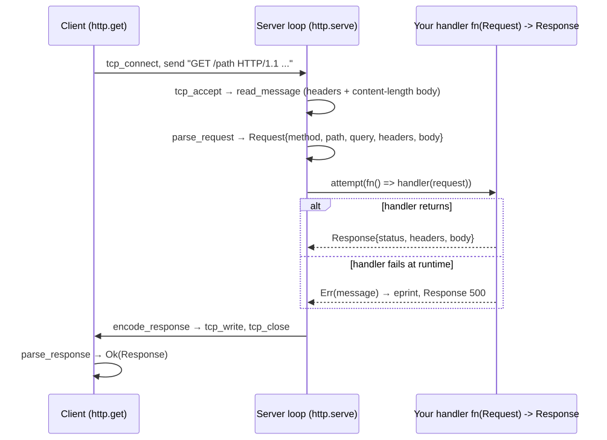

### Figure 12: Generics and monomorphization


### Figure 13: Closure call convention


### Figure 14: Traits and dispatch


### Figure 15: Parallelism


### Figure 16: Bytecode format


### Figure 17: Developer lifecycle


## Appendix B — Glossary

**Fact** — the compiler's static knowledge about an expression: type, interval, truth, length. **Frame** — a function activation on the VM stack. **Immortal** — a heap object that is never counted or freed (string constants). **Instantiation** — a generic function or struct compiled for concrete type arguments. **Monomorphization** — generating one copy of generic code per instantiation. **Program** — the compiler's output: tables plus bytecode. **Superinstruction** — a fused instruction produced by the peephole pass. **Thunk** — a generated C++ function with a uniform signature used to call closures. **Trial deletion** — the cycle-collection algorithm (§5). **Variant** — the runtime object behind `Option` and `Result`. **Vtable** — a struct's table of function ids for one trait.
